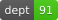

# shirodarts.com

[](https://github.com/shiroinock/shirodarts.com/blob/dept-badge/dept.md)

個人サイト shirodarts.com のソースコード

## Tech Stack

- HonoX - Ultra-fast web framework
- Cloudflare Pages - Deployment platform
- Biome - Linter & Formatter
- TypeScript - Type safety
- Terraform - Infrastructure as Code（オプション）

## Setup

### 1. Install dependencies

```bash
pnpm install
```

### 2. Install Gitleaks（機密情報スキャン）

```bash
# macOS
brew install gitleaks

# Linux
# https://github.com/gitleaks/gitleaks#installing
```

Gitleaksはコミット前に自動的に実行され、APIキーやトークンなどの機密情報の誤コミットを防ぎます。

### 3. Environment setup（オプション）

```bash
# 環境変数ファイルの作成
cp .env.example .env

# Terraform設定ファイルの作成
cp terraform/terraform.tfvars.example terraform/terraform.tfvars
```

## Development

```bash
# Start dev server
pnpm dev

# Build for production
pnpm build

# Preview production build
pnpm preview

# Deploy to Cloudflare Pages
pnpm deploy:cf
```

## Security

このプロジェクトは機密情報保護のため、以下の多層防御を実装しています：

- 🛡️ `.gitignore` - 機密ファイルの自動除外
- 🔍 Pre-commit hook - コミット前のGitleaksスキャン
- 🤖 GitHub Actions - CI/CDでのセキュリティスキャン

詳細は [SECURITY.md](./SECURITY.md) を参照してください。

## Infrastructure

Cloudflareの設定はTerraformで管理できます（オプション）。

詳細は [terraform/README.md](./terraform/README.md) を参照してください。
